<p align="center">
  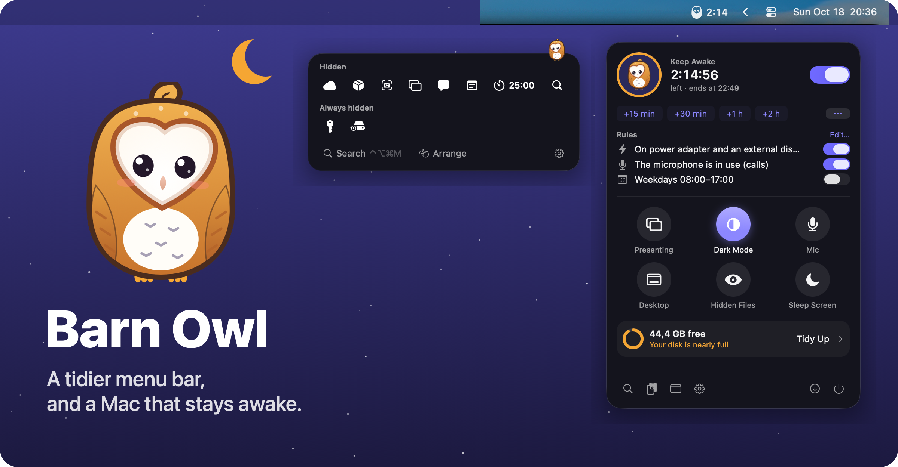
</p>

<p align="center">
  <b>A tidier menu bar, and a Mac that stays awake when you need it to.</b><br>
  Free and open source, for macOS 26 Tahoe and later.
</p>

<p align="center">
  <a href="https://github.com/marvika/barnowl/actions/workflows/ci.yml"></a>
  
  
  <a href="LICENSE"></a>
</p>

<p align="center">
  <a href="https://github.com/marvika/barnowl/releases/latest">Download</a> ·
  <a href="docs/user-guide.md">User guide</a> ·
  <a href="docs/how-it-works.md">How it works</a> ·
  <a href="docs/ROADMAP.md">Roadmap</a>
</p>

---

Barn Owl does two jobs that usually take two apps:

- **It tidies your menu bar.** It hides the icons you rarely use, keeps the ones
  you do in sight, and makes sure nothing gets lost behind the notch.
- **It keeps your Mac awake.** For an hour, until a time, while an app runs, or
  automatically by rules.

Around those it adds a few everyday tools you'll reach for: search, quick
toggles, clipboard history, a nest for your files, and a barn to keep your
disk tidy.

## Meet the owl

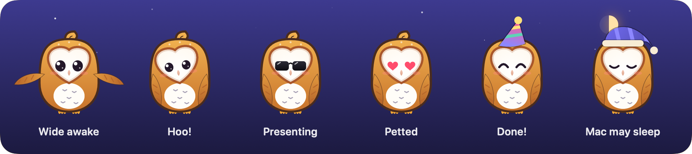

The owl lives in your menu bar. Its eyes are open while it keeps your Mac
awake and shut when your Mac may sleep. Inside the app it reacts to what
you're doing: it wears a headset during calls and shades while you present,
gets coffee on long sessions, covers its eyes when you copy a password, says
"Nom!" when you feed it a file, and waves goodbye when files leave the Nest.
Click it, pet it, throw it, or leave it alone until it nods off. There are
38 owl moments to meet; Settings → About keeps count.

Pick its colours in Settings → Appearance (**Golden Barn**, **Ghost Owl**,
**Ember** or **Moonlit Lilac**) and its personality: *Lively*, *Calm* or
*Still*. With Reduce Motion on, it keeps still. See
[the owl](docs/user-guide.md#the-owl) for everything it does.

## A tidy menu bar

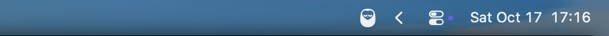

Barn Owl adds an arrow to your menu bar. Everything you don't need right now
waits behind it. Click the arrow, press **⌃⌥⌘B**, hover or scroll, and your
hidden icons appear on the **Perch**, a strip under the menu bar. Click
any icon there and its menu opens as usual. On a notched MacBook this is also
where icons that would otherwise sit behind the notch end up.

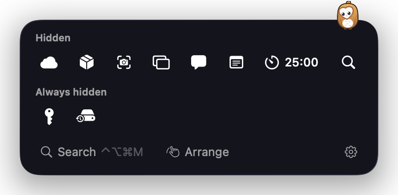

### Arrange by dragging

Settings → Layout shows every icon with its real picture. Drag icons between
**Menu bar**, **Hidden**, **Always hidden** and your groups, and Barn Owl moves
the real icons for you. There's no ⌘-dragging tiny icons, and nothing to lose
behind the notch. Right-click any icon for **Always Show in Menu Bar**,
**Hide**, **Replace Icon…** and more.

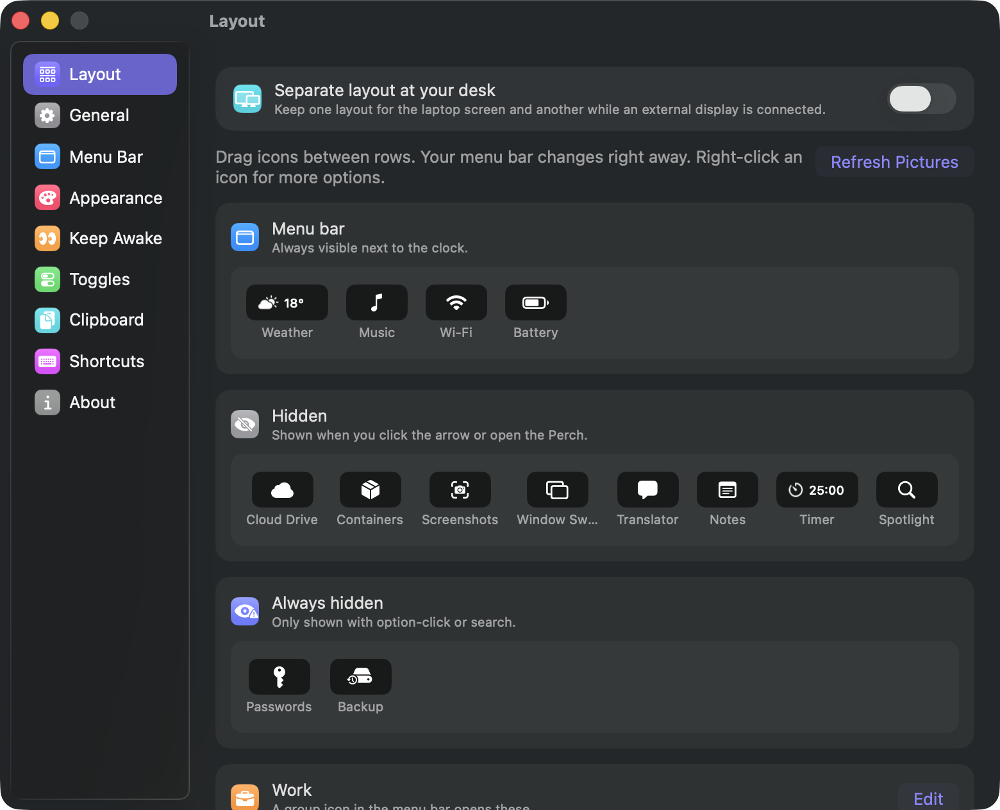

Icons stay where you put them. When an app restarts and macOS drops its icon
somewhere else, Barn Owl puts it back. New apps' icons go to Hidden, or to the
menu bar if you prefer.

### Groups and custom icons

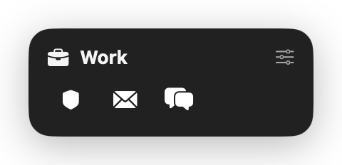

A **group** is one icon in the menu bar that opens a strip of others. For
example, a briefcase can hold your VPN, mail and chat apps. You can also
**replace any app's icon** with a symbol, an emoji or a bit of text, such as
"VPN". Clicking it opens the app's menu.

### It notices what matters

- **Show when it changes:** a hidden icon pops into view for a while when it
  changes. Your VPN dropped? Your cloud drive is out of sync? You'll see it.
- **Presenter mode:** sharing your screen in a call hides every icon
  automatically and keeps your Mac awake, then puts everything back when
  you stop.
- **Separate desk layout:** a roomier menu bar when an external display is
  connected, and a tight one on the laptop screen.

## Keep awake

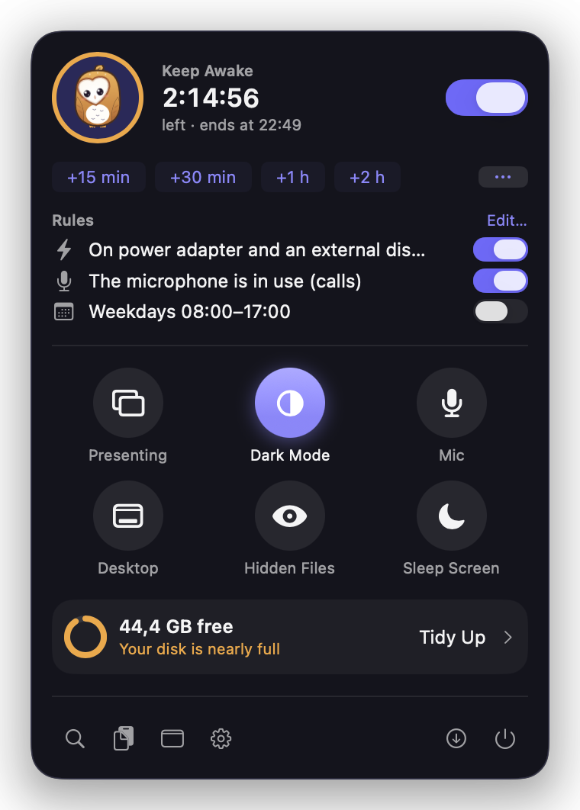

Click the owl for the quick panel. Barn Owl can keep your Mac awake:

- **For a while:** 15 minutes, 1 hour, 2 hours, 4 hours, or until you stop it.
  The time left counts down beside the owl, and you can add time with one
  click.
- **Until a time:** for example, until 17:30.
- **While an app runs:** say, while your build or a video export runs.
- **Until downloads finish.**
- **Automatically, with rules:** on power with an external display, during
  calls (whenever your microphone is in use), on weekdays 08:00–17:00, while
  Docker runs… You can combine conditions.

It stops below a battery level you choose. **Keep me available** stops Teams
and Slack from marking you Away. There's also an optional **closed-lid mode**.

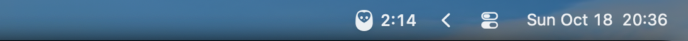

The quick panel also has one-click toggles: presenter mode, dark mode,
microphone mute, hide desktop icons, show hidden files and sleep display.

## Find anything, do anything

Press **⌃⌥⌘M** and type. You can find any menu bar icon, even hidden ones,
and press Return to open it. You can also type a command:

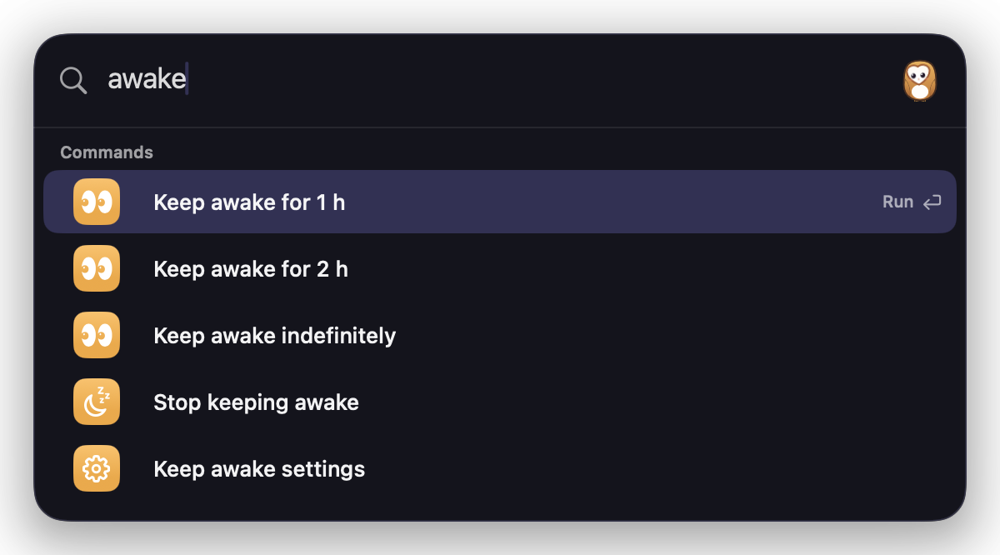

`awake 2h` · `awake +30` · `dark` · `present` · `mute` · `arrange` · `clipboard`

## The Barn: free up disk space

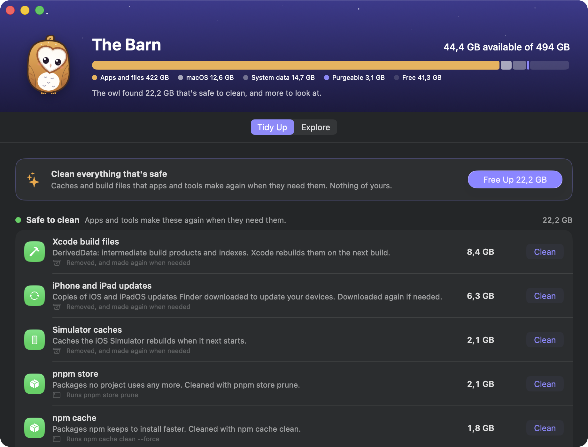

Click the disk row in the quick panel, or search for "disk", and the owl
shows you how your disk is used and what it can safely clean:

- **Tidy up**, sorted by how safe it is:
  - **Safe to clean:** browser and app caches, Xcode build files, iPhone
    update files, npm, pip and other tool caches. Free them all in one click.
  - **Check first:** macOS installers left behind, apps you haven't opened
    in six months, big old downloads, other apps' caches and logs, Homebrew's
    old versions. You pick what goes, it goes to the Trash, and Undo puts it
    back.
  - **Only you know:** iPhone backups, the Photos library, Xcode archives,
    Docker. Shown with advice, never cleaned for you.
- **Safe by design:** each clean-up can only touch its own folders, links
  are followed and checked, nothing is cleaned while its app or a build is
  running, and anything that can't be undone asks first. Every action is
  logged.
- **Explore:** a map of your disk, about three million files in half a
  minute, as rings to click through. It starts at your home folder, explains
  the system folders, finds the biggest files by kind, previews with Quick
  Look, and keeps a basket of what you decide can go. It won't take anything
  from iCloud Drive or where apps keep your data.
- **Keeps an eye out:** a gentle warning when the disk is nearly full, and,
  if you like, a weekly look for things to tidy. It never cleans by itself.

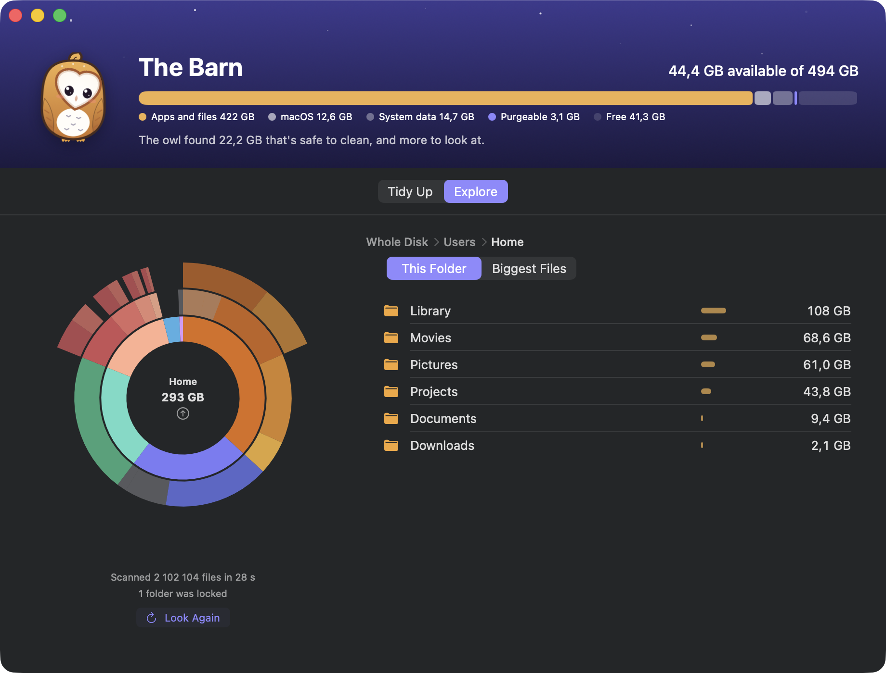

## Clipboard history and the Nest

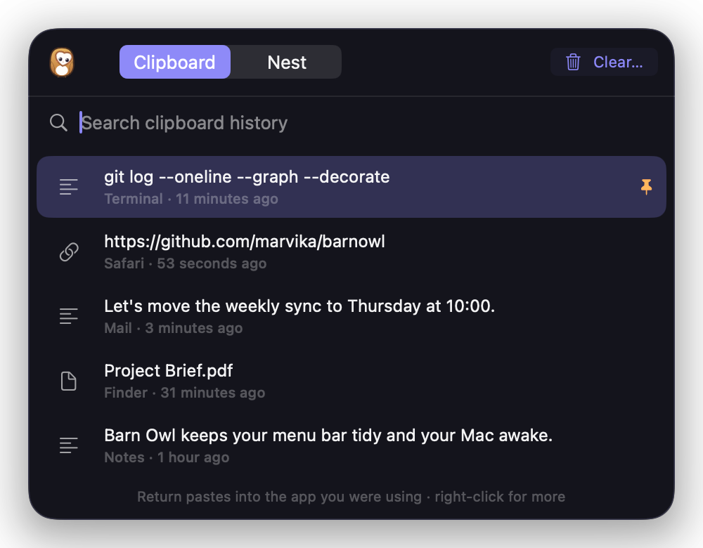

**⌃⌥⌘V** shows what you've copied: text, links, images and files. Press Return
to paste into the app you were using. Pin what you use often. Copies from
password managers are never recorded.

Start dragging files in any app and the **Nest** slides out under the
notch, with the owl watching your pointer. Drop files there to hold them,
then drag them out later, wherever you need them, one by one or all at once.
Once you've dropped a file somewhere, it leaves the Nest.

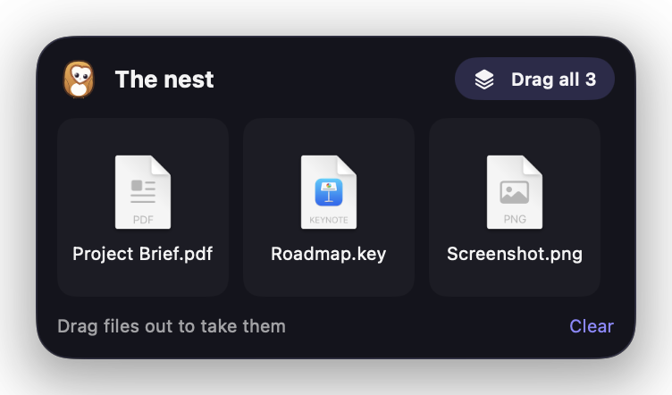

## Download

Requires macOS 26 Tahoe or later, on Apple silicon or Intel. On macOS 27,
hiding works a different way, per app rather than per icon, and has had less
testing; see [how it works](docs/how-it-works.md#hiding).

With [Homebrew](https://brew.sh):

```bash
brew install --cask marvika/tap/barn-owl
```

This also puts the `barnowl` command on your PATH. Or download it yourself:

1. Download **BarnOwl-x.y.z.zip** from the
   [latest release](https://github.com/marvika/barnowl/releases/latest)
   and open it.
2. Drag **Barn Owl** into your Applications folder and open it.
3. The setup guide takes it from there.

Barn Owl is signed and notarized by Apple, so it opens like any other app.
It can update itself: after the second launch it asks whether to check for
updates automatically, and it always asks before installing one. Settings →
General has the switch and a **Check for Updates…** button.

<p>
  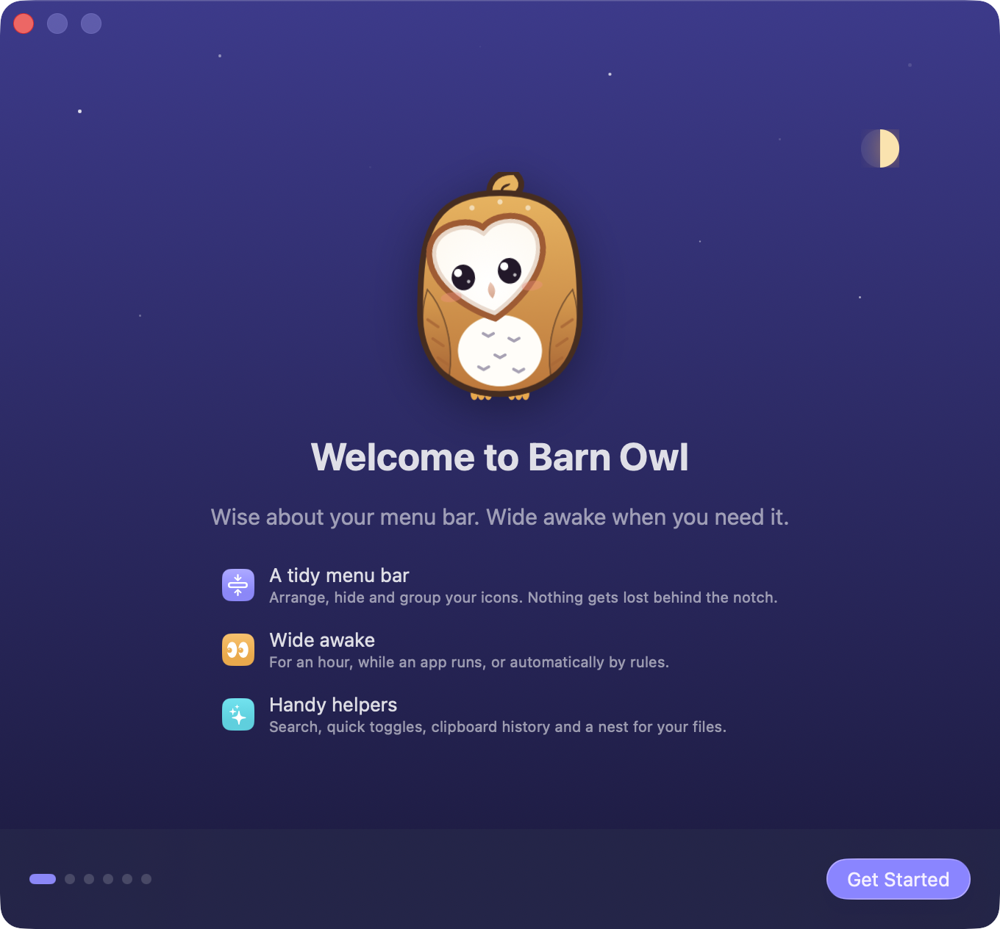
  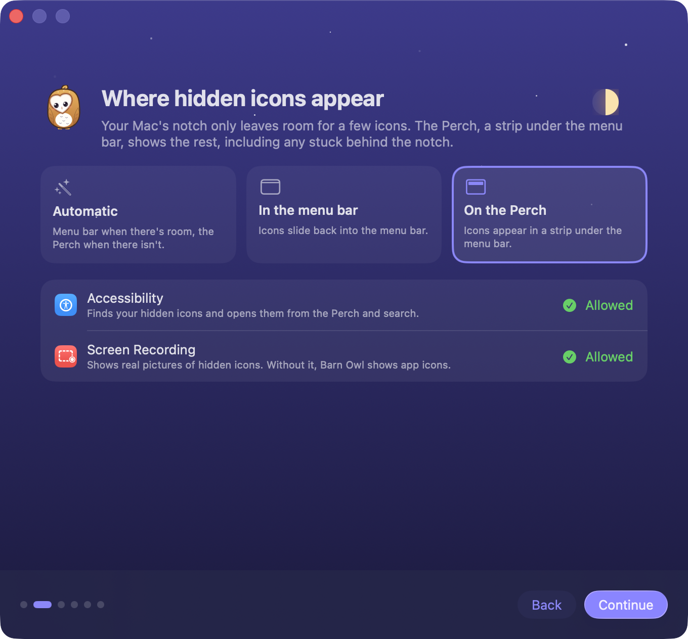
  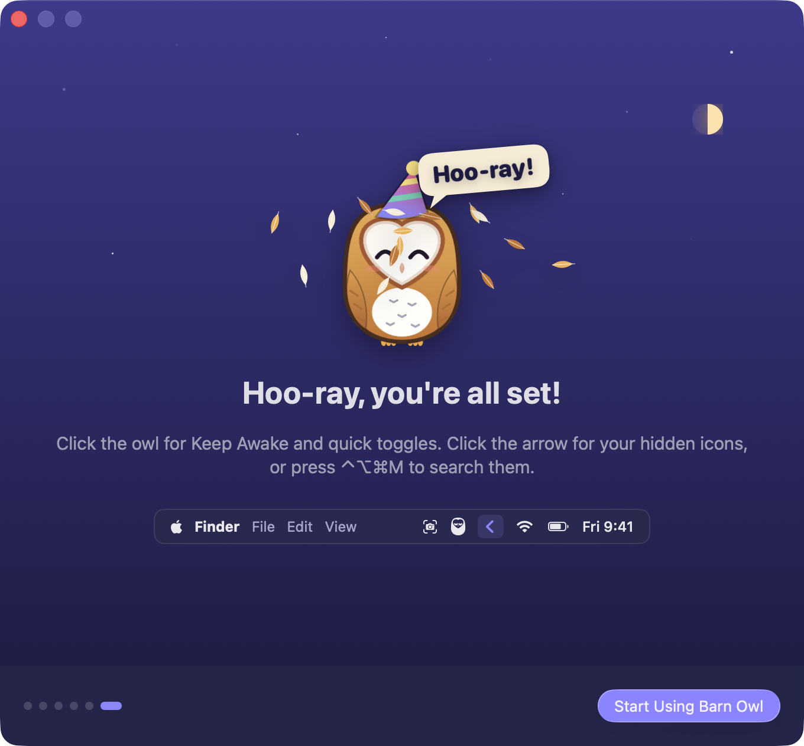
</p>

Prefer building it yourself? See [Building from source](#building-from-source).

## Keyboard shortcuts

| | |
|---|---|
| Show or hide hidden icons | ⌃⌥⌘B |
| Search the menu bar, run a command | ⌃⌥⌘M |
| Clipboard history | ⌃⌥⌘V |
| Show every icon | Option-click the arrow |
| Keep awake on or off | Option-click the owl |
| Keep awake, presenter mode | Set your own in Settings → Shortcuts |

## Automation

- **Shortcuts:** Keep Mac Awake, Stop Keeping Mac Awake, Set Presenter Mode,
  Show or Hide Menu Bar Icons, Open Menu Bar Icon, Show Clipboard History.
- **Terminal:** the `barnowl` command (on the release page, or installed by
  `Scripts/install.sh`):

  ```
  barnowl awake 90        barnowl awake +30       barnowl present on
  barnowl open vpn        barnowl place mail hidden
  barnowl icon vpn VPN    barnowl watch "cloud drive"
  ```

- **Links,** for Raycast, Alfred and scripts: `barnowl://keep-awake?minutes=60`,
  `barnowl://open?app=Mail`, `barnowl://settings?pane=layout` and more. See the
  [user guide](docs/user-guide.md#automation).

## Privacy and permissions

Barn Owl works entirely on your Mac. It has no accounts and no analytics. Its
only network request is checking GitHub for new versions: it downloads the
list of releases and sends nothing about you or your Mac. Switch automatic
checks off in Settings → General.

- **Accessibility** lets it list menu bar icons, move them and open them.
- **Screen Recording** lets it show real pictures of hidden icons. Without
  it, you see app icons instead.

Clipboard history stays on your Mac, skips password managers and never saves
images to disk. You can switch it off in Settings → Clipboard.

## Building from source

Requires Xcode 26 or later and [XcodeGen](https://github.com/yonaskolb/XcodeGen).

```bash
brew install xcodegen
Scripts/install.sh
```

This builds a Release copy, installs it in /Applications, puts the `barnowl`
command on your PATH and starts Barn Owl. Run it again to update. macOS trusts
apps built on the same Mac, so there's no "Open Anyway" step. Your copy checks
for updates too and offers the latest release; switch that off in Settings →
General to keep your own build.

For development, run `xcodegen generate`, open `BarnOwl.xcodeproj` and run the
tests:

```bash
xcodebuild -project BarnOwl.xcodeproj -scheme BarnOwl test
```

Builds are ad-hoc signed by default, and macOS forgets an ad-hoc build's
permissions on every rebuild. To keep them, copy
`Config/Local.xcconfig.example` to `Config/Local.xcconfig` and set your team
ID.

The screenshots come from a demo copy with made-up icons and data:
`Scripts/demo.sh` starts it, and `Scripts/demo.sh stop` brings your own
Barn Owl back. The owl pictures and the hero image are drawn by the app
itself: `Scripts/make-icon.sh` and `Scripts/make-hero.sh`.

To make a release, `Scripts/release.sh` builds Barn Owl with your Developer
ID, has Apple notarize it, staples the ticket, signs the zip for updates and
adds it to the update feed (`appcast.xml`) and the Homebrew cask. `--publish`
also creates a draft GitHub release, and `--dry-run` stops before notarizing.
See [CONTRIBUTING.md](CONTRIBUTING.md#making-a-release).

## Contributing

Bug reports, ideas and pull requests are welcome. See
[CONTRIBUTING.md](CONTRIBUTING.md) for how to build and test, and the
[changelog](CHANGELOG.md) for what's new. Please report security problems
privately, as [SECURITY.md](SECURITY.md) describes.

## Credits

Barn Owl learned from [Hidden Bar](https://github.com/dwarvesf/hidden) and
[Frost](https://github.com/frostbar/frost), both MIT; see
[THIRD_PARTY_NOTICES.md](THIRD_PARTY_NOTICES.md). It also learned from reading
[Ice](https://github.com/jordanbaird/Ice) and
[Thaw](https://github.com/thaw-app/Thaw), both GPL-3; no code was copied.
The Barn's approach to safe cleaning was inspired by
[Mole](https://github.com/tw93/mole) (GPL-3), and its map by
[DaisyDisk](https://daisydiskapp.com); no code was copied.
Hotkeys use [KeyboardShortcuts](https://github.com/sindresorhus/KeyboardShortcuts),
and updates use [Sparkle](https://sparkle-project.org).

## License

[MIT](LICENSE)
