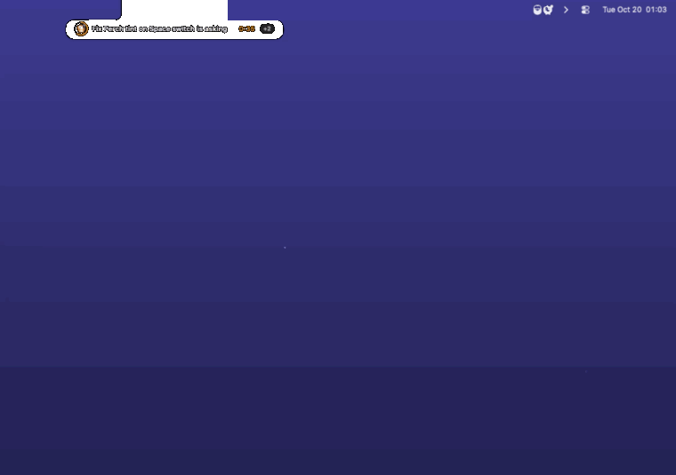
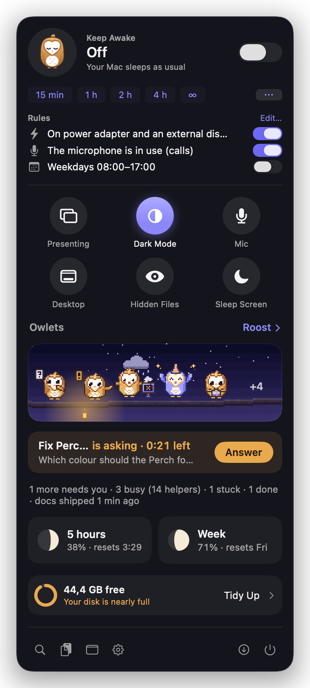
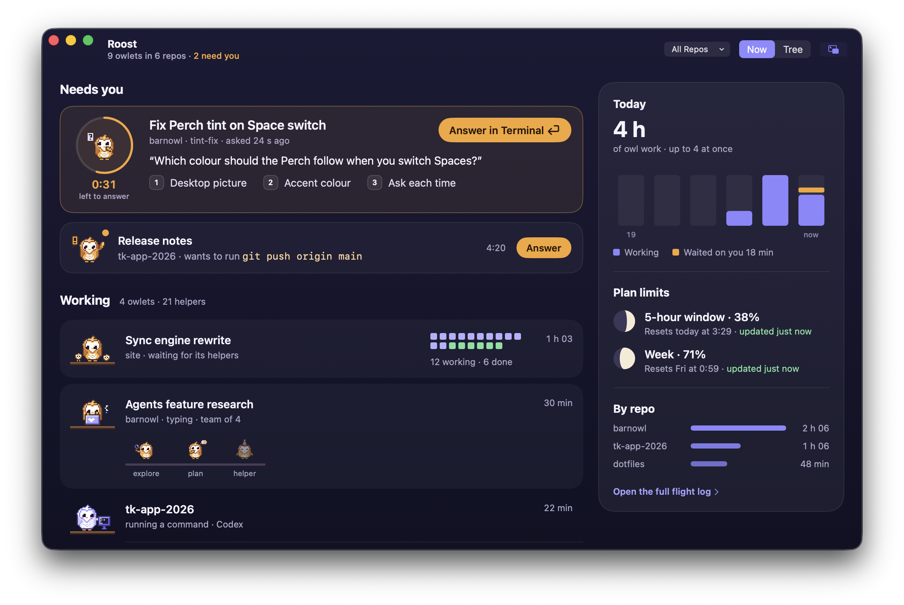
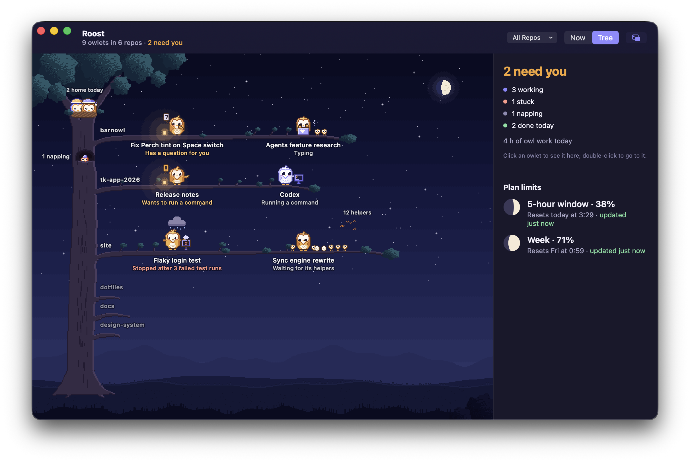
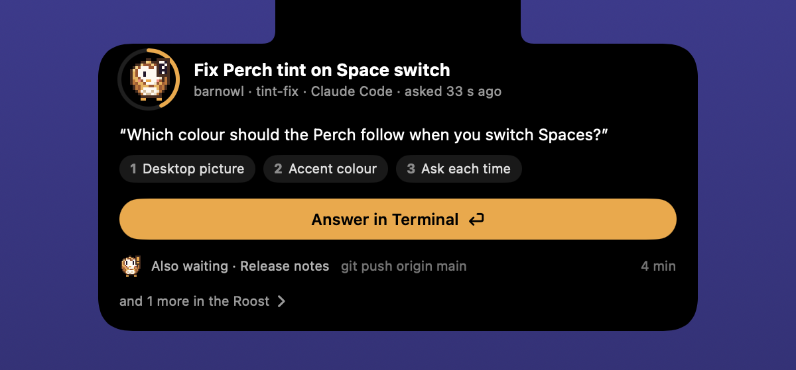
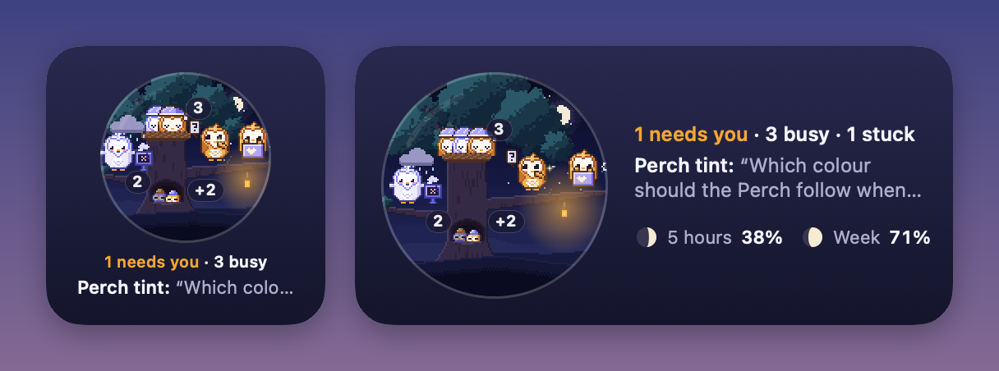
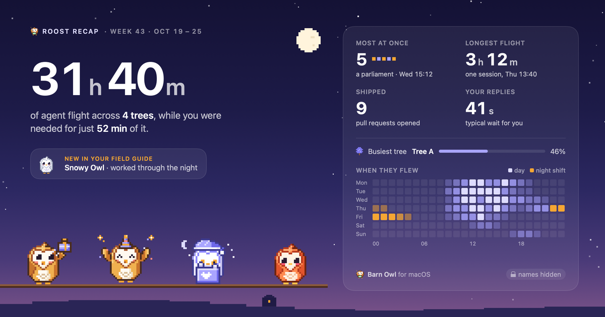
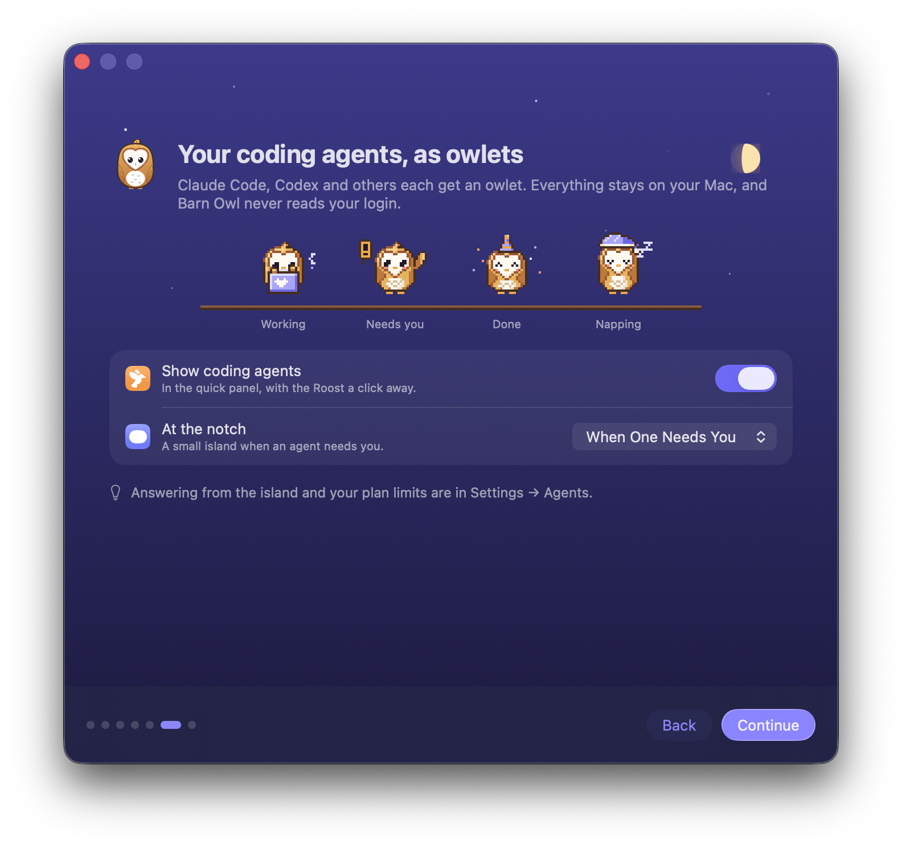

<p align="center">
  
</p>

<!--
  IMAGE: the hero's tagline row still reads "Tidy menu bar · Keep awake · Disk
  space · Coding agents". Redraw hero.png and social-preview.png with
  Scripts/make-hero.sh so Capture is in it.
-->

<!--
  CAPTURE-NEXT marks what describes Capture's phase 2 (screen recording, GIF,
  the video editor, scrolling capture, the new Frame backgrounds and the
  magnifier). It was written from the design's MUST items before they
  shipped. A CAPTURE-NEXT ... /CAPTURE-NEXT pair wraps whole paragraphs or
  sections; a single "CAPTURE-NEXT: ..." note names the phase 2 words in the
  paragraph, list or table right below it. Check each against the build, trim
  what didn't make it, then remove the markers. Everything else has shipped
  (0.15.0 and the Unreleased changelog).
-->

<h3 align="center">A tidy menu bar, and the small tools you reach for all day.</h3>

<!-- CAPTURE-NEXT: "screen recordings and GIFs" in the paragraph below is phase 2. -->
<p align="center">
  Barn Owl hides the menu bar icons you rarely use, then takes on the jobs
  you'd otherwise install several apps for: screenshots, screen recordings
  and GIFs, a Mac that stays awake, room on your disk, clipboard history,
  and your coding agents at a glance. One friendly owl. Free and open
  source, for macOS 26 Tahoe and later.
</p>

<p align="center">
  <a href="https://github.com/marvika/barnowl/releases/latest"></a>
  <a href="https://github.com/marvika/barnowl/actions/workflows/ci.yml"></a>
  
  
  <a href="LICENSE"></a>
</p>

```bash
brew install --cask marvika/tap/barn-owl
```

<p align="center">
  or <a href="https://github.com/marvika/barnowl/releases/latest"><b>download the app</b></a> ·
  <a href="#install">Install guide</a> ·
  <a href="docs/user-guide.md">User guide</a> ·
  <a href="docs/how-it-works.md">How it works</a> ·
  <a href="CHANGELOG.md">What's new</a>
</p>

## Why Barn Owl?

- **One app instead of several.** Menu bar hiding, screen capture,
  keep-awake, a disk cleaner, a clipboard and a home for your coding agents,
  all behind one small owl.
- **Native.** Written in Swift for macOS 26: Liquid Glass, notched MacBooks
  and Apple silicon, from the ground up. Under 1% CPU at idle.
- **Private.** Everything happens on your Mac. No account, no analytics, no
  cloud. Even the words in your screenshots are read on your Mac. The only
  network request is the update check.
- **Only what you want.** Every feature can be switched off, and a feature
  that's off does no work at all. Capture waits until you turn it on.
- **Careful.** Clean-ups are locked to their own folders, go to the Trash
  where they can, and ask before anything that can't be undone.
- **Free and open source,** under the MIT license. Signed and notarized by
  Apple.
- **And it has an owl.** It wears shades while you present, gets coffee on
  long sessions, and celebrates when you free up space.

<p align="center">
  
</p>

## What's inside

<!-- CAPTURE-NEXT: recordings, GIFs, the video editor and scrolling capture in the Capture row are phase 2. -->

|  |  |
|---|---|
| **[A tidy menu bar](#a-tidy-menu-bar)** | Hides the icons you rarely use and shows them on the **Perch** when you want them. Nothing gets lost behind the notch. |
| **[Capture](#capture)** | Screenshots with markup, screen recordings with sound, GIFs, a video editor and scrolling capture. Find any screenshot again by the words in it. |
| **[Keep awake](#keep-awake)** | For an hour, until a time, while an app runs, or by rules: during calls, at your desk, while an agent works. |
| **[Coding agents](#your-coding-agents)** | Claude Code, Codex and others as pixel owlets: who's working, who needs you, and what got done. |
| **[Disk space](#the-barn-free-up-disk-space)** | Finds caches, build files and forgotten installers, cleans the safe ones in one click, and maps your disk. |
| **[Everyday tools](#and-the-everyday-tools)** | Search and commands, clipboard history, quick toggles, and a Nest for files you're dragging around. |

## A tidy menu bar


Click the arrow, press **⌃⌥⌘B**, hover or scroll, and your hidden icons
appear on the **Perch**, a strip under the menu bar. Click any icon there and
its menu opens as usual.

- **Arrange by dragging** in Settings → Layout, with real pictures of every
  icon. Barn Owl moves the real icons for you.
- **Groups:** one icon that opens a strip of others, like a briefcase for
  your VPN, mail and chat.
- **Custom icons:** swap any app's icon for a symbol, an emoji or "VPN".
- **Show when it changes:** a hidden icon pops into view when it changes,
  so a dropped VPN doesn't go unnoticed.
- **Presenter mode:** share your screen and every icon hides at once, then
  comes back exactly where it was.
- **A separate layout at your desk,** used while an external display is
  connected.

More in the [user guide](docs/user-guide.md#hiding-icons).

<br clear="right">

## Capture

<!-- CAPTURE-NEXT (see the note at the top of this file) -->
Screenshots and screen recordings, each with an editor of its own, plus
GIFs and pages longer than your screen. Every capture stays editable, and
you can find it again later.
<!-- /CAPTURE-NEXT -->

Capture is optional: turn it on in Settings → Capture or in the setup guide.
Already happy with CleanShot X or Shottr? Leave it off, and Barn Owl stays
out of their way.

### Screenshots

<!-- IMAGE: docs/images/capture-overlay.png (760 wide): the frozen screen with an adjustable selection, its handles, the loupe and the action bar. From the demo copy. -->

Press **⌃⌥⌘4**. The screen freezes, so menus and hover states stay put while
you choose:

- **An area:** drag it. It stays adjustable, with handles, and a loupe shows
  the exact pixels.
- **A window:** click it. It's captured on its own, with its shadow.
- **The whole screen:** press F, or ⌃⌥⌘3 from anywhere.

Return copies and saves it, E opens the editor, P pins it above your
windows, and T copies the text in it. Every capture leaves out other apps'
menu bar icons and your desktop icons, without changing anything on screen.
A small card shows what you caught: click it to mark it up, or drag it
straight into Slack, Mail or any other app.

### Mark it up

<!-- IMAGE: docs/images/capture-editor.png (760 wide): the editor with a curved arrow, numbered steps, a callout, a magnifier and a Frame on a gradient. -->

The editor has tapered, bendable arrows, numbered steps with labels, text in
five styles and four typefaces, boxes and ovals, a highlighter that follows lines of
text, a pen that steadies your hand, spotlight, crop, and redaction that
pixelates, blurs or covers. Every tool has a single-letter key and remembers
how you last used it, and every mark stays movable until you're done.

<!--
  CAPTURE-NEXT. If the new Frame doesn't ship, the shipped wording is:
  **Frame** puts the capture on a gradient, a colour or your wallpaper, with
  padding, rounded corners, a shadow and an aspect ratio, ready to share.
-->
**Magnify** (M) enlarges a detail in a loupe, from 1.5× to 4×. It magnifies
your redactions along with the picture, so it never shows what you've
hidden.

**Frame** puts a capture on a background, ready to share. Choose one of nine
gradients, one of four matched to the colours in your capture, a plain
colour or your wallpaper, or make a gradient of your own in a few clicks;
Barn Owl keeps it under **Yours**. Then set the padding, corners and shadow,
and the shape for where it's going: 16:9, 1:1, 1.91:1 for link previews, 9:16
for stories and more. Frame remembers your last look.
<!-- /CAPTURE-NEXT -->

Barn Owl reads the text in each capture **on your Mac** and offers to hide
what looks private: API keys and tokens, passwords, card numbers, email
addresses and phone numbers. It never hides anything without asking.

<!-- CAPTURE-NEXT -->
### Record the screen

<!-- IMAGE: docs/images/capture-recording.png (760 wide): the record bar with the microphone menu, then the pill and border around an area being recorded. -->

Press **⌃⌥⌘5**, or R after you select, to record an area, a window or the
whole screen. A 3, 2, 1 countdown gives you a moment to get ready; press
Return to skip it. A small pill beside the area lets you pause, carry on,
stop or throw the take away, and the same shortcut or the menu bar stops it
too. Barn Owl's own controls never appear in the video.

- **Sound:** your Mac's own sound is one click away. The microphone stays
  off until you pick one, and Barn Owl says why before macOS asks.
- **GIFs:** press G instead of R to record straight to a GIF, or make one
  from any recording later, from its card or in the editor. GIFs loop, at 15
  frames a second and up to 800 pixels wide.
- **Like any capture:** a recording gets a card, a place in Capture History
  and a saved movie, with an option for smaller files.

### Edit a recording

<!-- IMAGE: docs/images/video-editor.png (760 wide): the video editor with the filmstrip timeline, a split clip, the Computer and Mic lanes, and the Export inspector. -->

The video editor is the screenshot editor's sibling. Drag a clip's ends to
trim it, split at the playhead with ⌘B, and delete a piece; the rest closes
up. Your Mac's sound and your microphone each have their own volume, or
mute either one. Export an MP4, a MOV or a GIF at the size and quality you
need. Every step can be undone, and a recording stays editable from Capture
History.

### Scrolling capture

<!-- IMAGE: docs/images/scrolling-capture.png (760 wide): a long page being captured, with the live preview growing beside it and the Scroll for Me button. -->

For a page longer than your screen, press **⌃⌥⌘S**, or S after you select.
Scroll down slowly, or click **Scroll for Me**, and watch the picture grow
beside it. A header or footer that stays put appears once, not on every
screenful. You get an ordinary capture, up to 30,000 pixels tall, to mark
up, copy and search.
<!-- /CAPTURE-NEXT -->

### Find it again

<!-- IMAGE: docs/images/capture-history.png (760 wide): Capture History with a search for one word and the screenshots that contain it. -->

- **Capture History** keeps every capture in one window, newest first, by
  day. Search finds a screenshot by the words in it. Open one with its marks
  still movable, or copy, pin or drag it out. Search for "history", or open
  it from Settings → Capture.
- **Copy Text:** press T on a selection, or ⌃⌥⌘T from anywhere, and the
  words in it go to the clipboard.
- **⌃⌥⌘E** reopens the last capture, marks and all.
- **Open With:** in Finder, open a PNG, JPEG or HEIC with Barn Owl. A
  screenshot Barn Owl saved comes back with its marks still movable.

Captures stay editable for 30 days, or 7, or not at all, as you choose in
Settings → Capture.

## Keep awake


Click the owl for the quick panel. Its eyes are open while your Mac is kept
awake, and the time left counts down beside it.

- **For a while,** until a time, while an app runs, or until downloads
  finish.
- **Rules** that switch it on by themselves: on power with an external
  display, during calls, while a coding agent works, on weekdays
  08:00–17:00. Combine conditions as you like.
- **Keep me available** stops Teams and Slack from marking you Away.
- **Closed-lid mode** keeps a MacBook running with the lid shut while it's
  awake, on battery too.
- It stops below a battery level you choose.

The same panel has one-click toggles for presenter mode, dark mode, the
microphone, desktop icons, hidden files and sleeping the screen.

<br clear="right">

## Your coding agents

<p align="center">
  
</p>

Run Claude Code, Codex, Mistral Vibe, Copilot CLI, OpenCode or Gemini CLI,
and each session gets a pixel **owlet** that shows what it's doing: typing,
running a command, searching, thinking, napping, or holding up a sign when it
needs you. Start ten at once and you still see, at a glance, which one is
waiting on you.



- **In the menu bar,** a small owlet sits beside the owl while agents work,
  with a dot when one needs you.
- **In the quick panel,** every owlet on a branch, the one that needs you
  with what it's asking and an **Answer** button, and your plan limits as
  moons that wax as you use them.
- **Show** takes you to the exact Terminal or iTerm tab, or the exact chat in
  the Claude app.
- **Your Mac stays awake** while an agent works, and for five minutes after.
- **Teams of helpers** stay readable: a few as hatchlings beside their
  owlet, a brood as a quiet grid of squares.

<br clear="right">

### The Roost



The **Roost** is their home. It opens on what needs you, with the actual
question or command and how long it has waited; then who's working and with
how many helpers; what got done today; and how the day went, hour by hour
and repository by repository, with your plan limits beside it.

Switch to the **Tree** and every owlet sits on one pixel tree: a branch per
repository, a lantern by the one that needs you, a rain cloud over the one
that's stuck, nappers curled up in the hollow and finished owlets asleep in
the nest, under a sky that follows the time of day. Pop it out into its own
window and keep it on top.



### The island



When an agent needs you, a small **island** grows out of the notch, with a
ring that counts down a question's minute. Hover to read the whole question
or command, then go straight to it.

If you like, answer Claude Code right there: **Allow Once**, **Deny**, its
own "don't ask again" rule (spelled out, so you know exactly what you're
allowing), or one of a question's options. Nothing is ever allowed without
your click, and the usual prompt takes over whenever you'd rather answer in
the terminal.

<br clear="right">

### On your desktop, and at the end of the week

A **desktop widget** keeps the Roost under a glass dome, changing with the
time of day. At the end of the week there's a **recap** to share, with your
repository names hidden unless you show them.

<p>
  
  
</p>

Barn Owl reads the agents' own session files on your Mac, never keeps your
prompts or replies, and never reads a login. Don't use coding agents? Turn it
all off in Settings → General → Features. More in the
[user guide](docs/user-guide.md#coding-agents).

## The Barn: free up disk space


Click the disk row in the quick panel, or search for "disk", and the owl
shows how your disk is used and what it can safely clean, sorted by how safe
it is:

- **Safe to clean:** browser and app caches, Xcode build files, iPhone
  updates, npm, pip and other tool caches. One click frees them all.
- **Check first:** macOS installers left behind, apps you haven't opened in
  six months, big old downloads. You pick what goes, and Undo puts it back.
- **Only you know:** iPhone backups, the Photos library, Docker. Shown with
  advice, never cleaned for you.

**Explore** maps the whole disk, about three million files in half a minute,
as rings to click through, with the biggest files by kind and a basket for
what can go.


More in the [user guide](docs/user-guide.md#the-barn-disk-space).

## And the everyday tools


- **Search, ⌃⌥⌘M:** find any menu bar icon, even hidden ones, or type a
  command: `awake 2h`, `awake +30`, `dark`, `present`, `mute`, `disk`,
  `roost`.
- **Clipboard history, ⌃⌥⌘V:** text, links, images and files. Pin what you
  use often. Copies from password managers are never recorded.
- **The Nest:** start dragging files and it slides out under the notch. Drop
  them there, then drag them out later, wherever you need them.

<p>
  
  
</p>

## Meet the owl


The owl's eyes are open while it keeps your Mac awake and shut when your Mac
may sleep. It wears a headset during calls and shades while you present,
covers its eyes when you copy a password, and says "Nom!" when you feed it a
file. There are 40 owl moments to find. Pick its colours (Golden Barn, Ghost
Owl, Ember or Moonlit Lilac) and its personality in Settings → Appearance.
With Reduce Motion on, it keeps still.

## Keyboard shortcuts

<!-- CAPTURE-NEXT: the ⌃⌥⌘5 and ⌃⌥⌘S rows, and R, G and S in the overlay line below the table, are phase 2. -->

| Menu bar and tools | | Capture | |
|---|---|---|---|
| Show or hide hidden icons | ⌃⌥⌘B | Capture an area or a window | ⌃⌥⌘4 |
| Search and commands | ⌃⌥⌘M | Capture the whole screen | ⌃⌥⌘3 |
| Clipboard history | ⌃⌥⌘V | Capture the same area again | ⌃⌥⌘R |
| Show every icon | Option-click the arrow | Copy text from the screen | ⌃⌥⌘T |
| Keep awake on or off | Option-click the owl | Edit the last capture | ⌃⌥⌘E |
| | | Start or stop a recording | ⌃⌥⌘5 |
| | | Scrolling capture | ⌃⌥⌘S |

While you capture: **F** the whole screen, **L** the last area, **Return**
copy and save, **E** edit, **P** pin, **T** copy text, **R** record, **G**
GIF, **S** scrolling capture, and **?** for every key.

Set your own in Settings → Shortcuts and Settings → Capture, where Barn Owl
can also take over ⇧⌘4 and ⇧⌘3 once macOS's own shortcuts are off.

## Automation

Shortcuts actions, a `barnowl` command for the Terminal (`barnowl awake 90`,
`barnowl open vpn`, `barnowl present on`) and `barnowl://` links for Raycast,
Alfred and scripts, such as `barnowl://roost` for the Roost or
`barnowl://capture` to capture an area. See the
[user guide](docs/user-guide.md#automation).

## Privacy

Barn Owl works entirely on your Mac. It has no accounts and no analytics.
Its only network request is checking GitHub for new versions, which sends
nothing about you or your Mac.

<!-- CAPTURE-NEXT: the Recordings item is phase 2. -->

- **Captures** stay on your Mac. Their text is read on your Mac, with
  Apple's Vision, to offer hiding private details, for Copy Text and for
  searching Capture History. To keep captures editable, Barn Owl stores the
  originals (unredacted) for 30 days (or 7, or not at all) in
  `~/Library/Application Support/Barn Owl/Captures`.
- **Recordings** stay on your Mac too. The microphone is off until you pick
  one, and Barn Owl hears it only while you record. Your Mac's own sound is
  recorded only when you turn it on.
- **Clipboard history** skips password managers and anything marked
  private, and never saves images to disk.
- **Coding agents:** Barn Owl reads the agents' session files in
  `~/.claude`, `~/.codex` and `~/.vibe`, and the Claude app's session
  records and usage history. It shows what an agent is waiting on you for
  while it waits, never keeps your prompts or replies, and never reads a
  login. It changes Claude Code's settings only if you turn on answering
  from the island or Claude's reset times, after showing you the exact
  change and saving a backup.

The details are in [SECURITY.md](SECURITY.md).

## Install

Barn Owl needs **macOS 26 Tahoe or later**, on Apple silicon or Intel. It's
signed and notarized by Apple, so it opens like any other app.

### With Homebrew (recommended)

```bash
brew install --cask marvika/tap/barn-owl
```

This installs Barn Owl in Applications and puts the `barnowl` command on
your PATH. Open **Barn Owl** from Applications or Spotlight.

### Or download it

1. Download **BarnOwl-x.y.z.zip** from the
   [latest release](https://github.com/marvika/barnowl/releases/latest).
2. Double-click the zip if your browser didn't unzip it.
3. Drag **Barn Owl** into your **Applications** folder.
4. Open it. The owl appears in your menu bar, and a short setup guide starts.

<p>
  
  
  
  
</p>

<!-- IMAGE: the setup guide's Capture step has no picture here. Add docs/images/setup-capture.png (200 wide) to this row. -->

### First launch

The setup guide walks you through where hidden icons appear, which icons
stay visible, your shortcuts, opening at login, Capture and the coding
agents. macOS asks for permissions only as each feature needs them:

<!-- CAPTURE-NEXT: the Microphone row is phase 2. -->

| Permission | What it's for | Needed? |
|---|---|---|
| **Accessibility** | Listing, moving and opening menu bar icons | For hiding and arranging icons |
| **Screen Recording** | Real pictures of hidden icons on the Perch, and Capture | For Capture. Otherwise optional: without it you see app icons |
| **Microphone** | Your voice in a screen recording | Only if you pick a microphone |
| **Automation** | Bringing an agent's Terminal or iTerm tab to the front; switching dark mode | Asked the first time you use it |
| **Notifications** | Telling you when an agent needs you and the island can't, or a session ends | Optional |
| **Full Disk Access** | Letting the Barn look in the Trash, Mail and Safari caches, and iPhone backups | Optional |

You can grant or revoke any of them later in System Settings → Privacy &
Security. Barn Owl's own Settings show whether Accessibility and Screen
Recording are on, with a button to turn each on.

### Updates

Barn Owl checks GitHub for new versions and asks before installing one. With
Homebrew you can also run `brew upgrade --cask barn-owl`.

### Uninstall

If you turned on **answering from the island** or **reset times for
Claude**, turn them off first in Settings → Agents, so Claude Code's
settings go back to how they were. (They do nothing once Barn Owl is gone,
so it's tidiness rather than necessity.) Then:

```bash
brew uninstall --zap --cask barn-owl
```

or quit Barn Owl and drag it from Applications to the Trash. Its settings
live in `~/Library/Preferences/io.github.marvika.BarnOwl.plist` and its
data in `~/Library/Application Support/Barn Owl`.

## Building from source

Requires Xcode 26 or later and [XcodeGen](https://github.com/yonaskolb/XcodeGen).

```bash
brew install xcodegen
Scripts/install.sh
```

This builds a Release copy, installs it in /Applications and starts it. For
development, tests, the demo copy used for screenshots and the release
process, see [CONTRIBUTING.md](CONTRIBUTING.md).
[docs/how-it-works.md](docs/how-it-works.md) explains how hiding, moving and
opening icons work.

## Contributing

Bug reports, ideas and pull requests are welcome; see
[CONTRIBUTING.md](CONTRIBUTING.md). Please report security problems
privately, as [SECURITY.md](SECURITY.md) describes.

## Credits

<!-- CAPTURE-NEXT: the macshot sentence is phase 2. Keep it only if recording and scrolling capture did take ideas from it. -->

Barn Owl learned from [Hidden Bar](https://github.com/dwarvesf/hidden) and
[Frost](https://github.com/frostbar/frost), both MIT; see
[THIRD_PARTY_NOTICES.md](THIRD_PARTY_NOTICES.md). It also learned from reading
[Ice](https://github.com/jordanbaird/Ice) and
[Thaw](https://github.com/thaw-app/Thaw), both GPL-3; no code was copied.
The Barn's approach to safe cleaning was inspired by
[Mole](https://github.com/tw93/mole) (GPL-3), and its map by
[DaisyDisk](https://daisydiskapp.com); no code was copied.
Capture's recording and scrolling capture took ideas from
[macshot](https://github.com/sw33tlie/macshot) (GPL-3); no code was copied.
Hotkeys use [KeyboardShortcuts](https://github.com/sindresorhus/KeyboardShortcuts),
and updates use [Sparkle](https://sparkle-project.org).

## License

[MIT](LICENSE)
