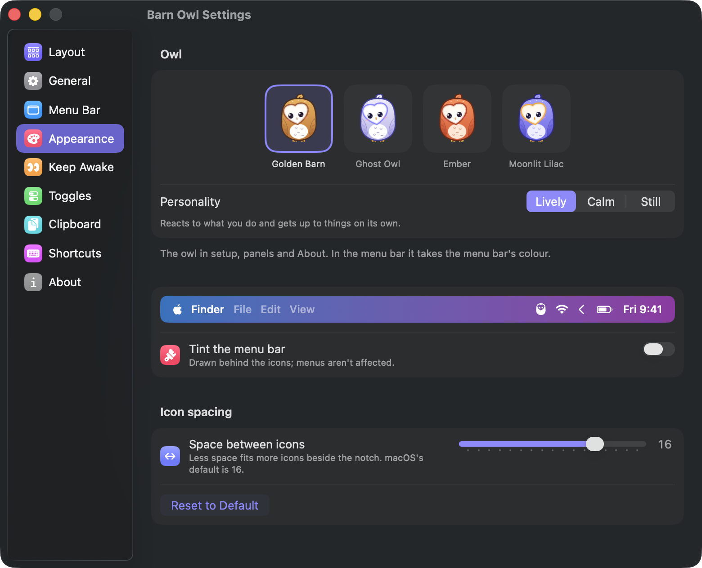

# Barn Owl user guide

- [Getting started](#getting-started)
- [Hiding icons](#hiding-icons)
- [Arranging icons](#arranging-icons)
- [Groups and custom icons](#groups-and-custom-icons)
- [Show when it changes](#show-when-it-changes)
- [Presenter mode](#presenter-mode)
- [A separate layout at your desk](#a-separate-layout-at-your-desk)
- [Keep awake](#keep-awake)
- [Quick panel and toggles](#quick-panel-and-toggles)
- [Search and commands](#search-and-commands)
- [Clipboard history and the Nest](#clipboard-history-and-the-nest)
- [The Barn: disk space](#the-barn-disk-space)
- [Appearance](#appearance)
- [The owl](#the-owl)
- [Automation](#automation)
- [Updates](#updates)
- [Troubleshooting](#troubleshooting)

## Getting started

When Barn Owl opens for the first time, a short setup guide walks you through
it. You can run it again any time from Settings → General → Setup guide.

Barn Owl asks for two permissions in **System Settings → Privacy & Security**:

| Permission | What it's for | Without it |
|---|---|---|
| Accessibility | Listing, moving and opening menu bar icons | Hiding still works; the Perch, search, arranging and groups don't |
| Screen Recording | Real pictures of hidden icons | You see app icons instead of the real icons |

macOS applies Screen Recording only after Barn Owl restarts. The setup guide
and Settings offer a **Relaunch Barn Owl** button for that.

Turn on **Open at login** in Settings → General to keep your menu bar tidy
from the start.

## Hiding icons

Barn Owl adds an **arrow** to your menu bar, next to Control Center, and a
`|` divider left of it. Icons left of the divider are hidden.

- **Click the arrow** or press **⌃⌥⌘B** to see your hidden icons. Click again
  to hide them.
- **Option-click the arrow** to show everything, including always-hidden
  icons.
- **Right-click the arrow** for the quick panel.

### Where hidden icons appear

Choose in Settings → Menu Bar:

- **On the Perch:** a strip under the menu bar. Click an icon and
  Barn Owl brings it next to the arrow and opens its menu, then puts it back.
- **In the menu bar:** hidden icons slide back into the menu bar itself.
- **Automatic** (the default): the menu bar when there's room, the Perch
  when there isn't. On a notched MacBook that's usually the Perch,
  because only a few icons fit beside the notch. Icons that end up behind
  the notch always show on the Perch.

### Other options (Settings → Menu Bar)

- **Hide icons again automatically** after a few seconds (on by default).
  Barn Owl waits while your pointer is in the menu bar.
- **Always-hidden section:** a second `⋮` divider. Icons left of it stay
  hidden until you option-click the arrow, search for them, or open them from
  a group.
- **Show hidden icons when hovering over the arrow**, or **scroll over the
  menu bar** (down shows, up hides). Both are off by default.
- **New icons go:** hidden (the default) or in the menu bar.

## Arranging icons

Open **Settings → Layout**, or click **Arrange** in the Perch.

Every icon appears with its real picture in rows: **Menu bar**, **Hidden**,
**Always hidden**, and one row per group. Drag an icon to another row, or onto
another icon to put it right before that one. Barn Owl moves the real icon
straight away.

Right-click an icon for:

- **Always Show in Menu Bar**, **Hide**, **Always Hide**
- **Move to Group**
- **Replace Icon…** (see below)
- **Show When It Changes** (see below)

The clock and Control Center have a lock: macOS doesn't let anyone move them.

You can still ⌘-drag icons in the menu bar itself, as with any Mac, and
Barn Owl remembers that too.

**Refresh Pictures** in Layout fills in icons that show an app icon instead
of their real picture. Icons behind the notch or off screen can't be
photographed, so Barn Owl briefly brings each one into view.

### Icons stay where you put them

Barn Owl remembers which row each icon belongs to. When an app restarts and
macOS puts its icon somewhere else, Barn Owl moves it back. If it can't keep
an icon in place after two tries, it stops trying, so your pointer is never
kept busy.

## Groups and custom icons

**Groups** gather several icons behind one. In Settings → Layout click
**New Group**, give it a name and an icon, then drag icons into its row. The
group's icon appears in the menu bar. Click it for a strip with its icons, or
right-click it to edit. The icons themselves wait in the always-hidden
section.

**Custom icons** replace one app's icon with a symbol, an emoji or a bit of
text. Right-click the icon in Layout or the Perch and choose **Replace
Icon…**. Clicking your icon opens the app's menu directly. To go back,
delete the custom icon's group in Layout (Edit → Delete Group).

## Show when it changes

Right-click an icon and choose **Show When It Changes**. When the icon
changes, Barn Owl shows it next to the arrow for 30 seconds (adjustable in
Settings → Menu Bar), then hides it again.

macOS can't photograph hidden icons, so Barn Owl watches what it can:

- every few seconds: the icon's **status text** (many apps include their
  state there), its **width**, and whether the app **re-added** the icon;
- right after the **network changes** (for example, a VPN connecting or
  dropping): a quick look at the watched icons' pictures;
- optionally every 2 or 10 minutes: the same quick look. Each look slides the
  icon into view for a moment.

Watched icons have a small bell in Layout.

## Presenter mode

Presenter mode hides every other app's icon and keeps your Mac and display
awake while you present. The clock and Control Center stay, and so does
macOS's own camera and screen-recording indicator.

- It **starts by itself** when you share or record your screen, and stops
  when you're done. Barn Owl reads this from macOS's own screen-recording
  indicator. Turn it off in Settings → Menu Bar → Presenter mode.
- Start or stop it yourself with the **Presenting** tile in the quick panel,
  a shortcut, `barnowl present on`, or the Shortcuts action.
- Optionally it also **hides desktop icons**, behind a picture of your
  wallpaper. Finder isn't touched, so the icons come back exactly where they
  were.

While presenting, the arrow shows an eye-slash. Clicking it opens the
Perch, so your hidden icons only appear if you choose to show them.

## A separate layout at your desk

Turn on **Separate layout at your desk** in Settings → Layout. Barn Owl then
keeps two layouts: one for the laptop screen alone, and one for when an
external display is connected. It switches when you connect or disconnect a
display. Arrange your icons while docked to set up the desk layout.

## Keep awake

Click the **owl** in the menu bar (or right-click the arrow) for the quick
panel. Its eyes are open while your Mac is kept awake.

- **Set:** keep awake for 15 minutes, 1, 2 or 4 hours, or indefinitely (∞).
- **Add:** during a timed session, add 15 or 30 minutes, 1 or 2 hours.
- **⋯** for **until a time**, **while an app is running**, or **until
  downloads finish**.
- **Option-click the owl** to start or stop without opening the panel.

During a timed session the owl shows the **time left**, for example "42m" or
"1:05". You can turn that off in Settings → Keep Awake.

### Rules

Rules keep your Mac awake by themselves while all their conditions hold. Add
them in Settings → Keep Awake → **Add Rule**, from a ready-made rule or a
custom one:

- on power adapter
- an external display is connected
- the microphone is in use (calls)
- files are downloading
- a particular app is running
- a schedule, for example weekdays 08:00–17:00

Each rule can let the display sleep or keep it on.

### Options

- **Let the display sleep:** the Mac keeps running; only the screen turns
  off.
- **Keep me available:** while keeping awake, nudges the pointer by one pixel
  every few idle minutes, so Teams and Slack don't show you as Away. It
  pauses while the display may sleep, since a nudge would keep the display on
  and stop your Mac from locking.
- **Stop when battery is below** 5, 10 (the default), 20 or 30%.
- **Notify me when a session ends.**
- **Closed-lid mode:** keeps the Mac running with the lid closed, even
  without an external display. It asks for your administrator password each
  time you switch it, and Barn Owl turns it off again when it quits. A closed
  Mac that keeps running gets warm, so don't put it in a bag like that.

## Quick panel and toggles

Besides keep awake, the quick panel has one-click toggles:

| Toggle | What it does |
|---|---|
| Presenting | Presenter mode on or off |
| Dark Mode | Switches the system appearance (asks once for permission to control System Events) |
| Microphone | Mutes or unmutes the default microphone for every app |
| Hide Desktop | Covers the icons on your desktop with your wallpaper; they come back where they were |
| Hidden Files | Shows or hides dotfiles in Finder (Finder quits and reopens, keeping its windows) |
| Sleep Display | Turns the screen off right away |

Choose which toggles appear in Settings → Toggles.

## Search and commands

Press **⌃⌥⌘M**. Type part of an icon's name to find it, hidden or not, and
press Return to open it. Hidden icons come first, labelled with where they
are.

You can also type a command:

| Type | To |
|---|---|
| `awake`, `awake 2h`, `awake 90`, `awake forever` | Keep awake |
| `awake +30` | Add time |
| `stop` | Stop keeping awake |
| `present` | Presenter mode |
| `dark` | Dark mode |
| `mute` | Mute or unmute the microphone |
| `desktop`, `hidden files`, `sleep` | The other toggles |
| `clipboard` | Clipboard history |
| `arrange` | Settings → Layout |
| `settings`, `rules`, `shortcuts`… | That Settings pane |

## Clipboard history and the Nest

Press **⌃⌥⌘V** for **clipboard history**: text, links, images and files you
copied, newest first. Type to search, use the arrow keys, and press Return to
paste into the app you were using. Right-click an entry to copy, pin or
delete it. Pinned entries stay at the top and are never cleared.

Barn Owl never records copies from password managers. They mark their copies
as private, and Barn Owl also skips 1Password, Bitwarden, Passwords, Keychain
Access and others by name. Text history is kept across restarts (you can turn
that off). Images stay in memory only. Turn history off entirely in Settings →
Clipboard.

The **Nest** appears under the notch as soon as you start dragging files in
any app, and the owl watches your pointer until you let go. Drop them there to
hold them. While it holds files, a small tab stays under the notch. Hover over
it or click it to see them, then drag them out wherever you need them, one at
a time or with **Drag all**.

A file leaves the Nest once you drop it somewhere; dropping it back on the
Nest keeps it. To keep files in the Nest instead, turn on **Keep files in the
Nest after dragging them out** in Settings → Clipboard.

The Nest only remembers where the files are. Where you drop them decides what
happens, as with any drag: Finder moves a file to another folder on the same
disk, and copies it to another disk (hold Option to copy instead). Files you
move or delete elsewhere leave the Nest by themselves. The **Nest** tab in
clipboard history shows the same files. Turn off the Nest or its tab in
Settings → Clipboard.

## The Barn: disk space

Open the Barn from the disk row in the quick panel, by searching for "disk"
or "barn", with `barnowl barn`, or with `barnowl://barn`.

The bar at the top adds up to your whole disk: your apps and files, macOS
itself, system data (swap, recovery and startup files, snapshots), what's
**purgeable** (caches, iCloud copies and snapshots macOS removes by itself
when it needs room) and what's free. Finder counts purgeable space as free.

### Tidy up

The owl looks in the places it knows: Xcode build files and caches, Homebrew,
npm, pnpm, Yarn, pip, CocoaPods, Swift packages, Go and Cargo caches,
browser caches, other apps' caches and logs, old installers in Downloads,
and the Trash. Each card shows how much you'd get back and how safe it is:

- **Safe to clean:** rebuilt automatically when needed. **Free Up** cleans
  all of these at once. Where a tool has its own clean-up command (`brew
  cleanup`, `npm cache clean`, `pnpm store prune`, `pip cache purge`, `xcrun
  simctl delete unavailable`), Barn Owl uses it.
- **Pick what goes:** probably fine, but you choose. Most go to the Trash, so
  **Undo** puts them back.
- **Your call:** iPhone backups, Xcode archives, simulator devices and
  Docker. Shown with advice, never cleaned by Barn Owl.

A cache is skipped while its app is running ("Quit Xcode first"). Every
removal is checked twice against a list of folders Barn Owl may touch, and
anything it isn't sure about is kept. What it did is written to
`~/Library/Logs/Barn Owl/cleanup.log`.

Things moved to the Trash still take space until you empty the Trash.

### Explore

**Look Through the Disk** scans everything, usually in under a minute, and
draws a ring map: the centre is the folder you're in, each ring a level
deeper, each slice as wide as its share. Hover to see what it is, click a
folder to go in, click the centre to go back. Beside it, the folder's
contents biggest first, or the **Biggest Files** anywhere. Press Space for
Quick Look, or right-click to show it in Finder or put it in the **basket**.
**Move to Trash** sends everything in the basket to the Trash.

Sizes are what files really take on disk. Hard links count once, iCloud
files that aren't downloaded count as nothing (and are never downloaded),
and other disks are left out.

### Full Disk Access

Without it, the owl can't see the Trash, Mail, Safari, iPhone backups or other
apps' private folders; Explore shows them as locked. To allow it, open
**System Settings → Privacy & Security → Full Disk Access** and turn on Barn
Owl (the Barn has a button that goes straight there).

### Keep it clean

At the bottom of Tidy Up: **Warn me when the disk is nearly full** (on by
default, at most once a day, when less than 10 GB or a twentieth of the disk
is free), and **Look for things to tidy once a week** (off by default). Both
only tell you; nothing is cleaned without you.

## Appearance

Settings → Appearance:



- **Owl:** pick the owl's colours: Golden Barn, Ghost Owl, Ember or Moonlit
  Lilac. They apply to the owl in setup, panels and About; in the menu bar
  the owl takes the menu bar's colour.
- **Tint the menu bar** (off by default) with a colour or gradient, full width,
  as a rounded pill, or split around the notch, with an optional border and
  shadow.
- **Space between icons:** less space fits more icons beside the notch.
  Apps pick up the new spacing when they next start. **Apply to System Icons**
  restarts the system's own icons; log out and back in to apply it
  everywhere. **Reset to Default** goes back to macOS's spacing.

## The owl

The owl in the menu bar has its eyes open while your Mac is kept awake and
shut when it may sleep. It blinks now and then, its eyes follow your pointer
when you hover over it, it winks when you Option-click it, it wears shades
while you present, and its eyes droop in the last minute of a timed session.
When an icon pops into view because it changed, the owl glances at it.

Inside Barn Owl it has a life of its own:

- **Click it** for a hoot and a hop. Click three times quickly and it turns
  its head all the way round; keep clicking and it gets dizzy.
- **Press and hold** to pet it. In About, **grab it and throw it**.
- **Quick panel:** it stretches when keep-awake starts and yawns when it
  stops. It reacts to the toggles: glowing eyes for Dark Mode, "Shh!" for a
  muted microphone, "Peekaboo!" when the desktop hides. It wears a headset
  during calls, glasses at your desk, a blanket in closed-lid mode, and gets
  coffee the longer you stay up (two hours, five, then an all-nighter). It
  perks up when you plug in, and looks tired on a low battery.
- **The Nest:** it peeks over the tab, leans in when a file comes near, says
  "Nom!" if you drop one right on it, waves "Bye!" when a file leaves, and
  sweeps up when you clear it.
- **The Perch:** it sits on the corner and watches the icon you point at.
- **Search:** it watches the selected result and hops when exactly one thing
  matches. Try typing "hoot" or "dance".
- **Clipboard:** it covers its eyes when Barn Owl skips a password, and its
  chest turns the colour of a colour code you copy, like `#F5A633`.
- **Now and then:** it says good morning once a day, is livelier after
  midnight, nods off if you leave it alone (move the mouse to startle it),
  and dresses up for Halloween, December, New Year and its birthday. The
  dusk sky shows tonight's real moon.
- **In the Terminal:** `barnowl hoot`.

Settings → About shows how many of its moments you've met.

Settings → Appearance has its colours and its **personality**: *Lively* does
everything, *Calm* only reacts to what you do, and *Still* keeps it still.
With **Reduce Motion** on (System Settings → Accessibility → Display), it
keeps still too.

## Automation

### Shortcuts

Barn Owl adds these actions to the Shortcuts app: **Keep Mac Awake** (minutes),
**Stop Keeping Mac Awake**, **Set Presenter Mode**, **Show or Hide Menu Bar
Icons**, **Open Menu Bar Icon** (by app name) and **Show Clipboard History**.
Barn Owl needs to be running.

### Terminal

`barnowl` is installed by `Scripts/install.sh`, or download it from the release
page and move it to `/opt/homebrew/bin`.

```
barnowl show | hide | toggle | all       hidden icons
barnowl bar | search | clipboard         panels
barnowl awake [minutes|+minutes|stop]    keep awake (no minutes = until stopped)
barnowl present [on|off]                 presenter mode (no argument = toggle)
barnowl open <app>                       open an app's menu bar icon
barnowl place <app> visible|hidden|alwaysHidden
barnowl watch <app> [off]                show the icon when it changes
barnowl icon <app> <text>|reset          replace an app's icon with text or an emoji
barnowl settings [pane]                  open Settings
```

### Links

For Raycast, Alfred, scripts and anything that can open a URL:

| Link | Does |
|---|---|
| `barnowl://show`, `barnowl://hide`, `barnowl://toggle`, `barnowl://show-all` | Hidden icons |
| `barnowl://bar`, `barnowl://search`, `barnowl://clipboard` | Panels |
| `barnowl://keep-awake?minutes=60` (0 = indefinitely) | Keep awake |
| `barnowl://keep-awake/extend?minutes=30` | Add time |
| `barnowl://keep-awake/stop` | Stop |
| `barnowl://presenter`, `?on=1`, `?on=0` | Presenter mode |
| `barnowl://open?app=Mail` | Open an app's icon |
| `barnowl://place?app=Mail&row=hidden` | Move an icon |
| `barnowl://watch?app=Mail` (`&on=0` to stop) | Show when it changes |
| `barnowl://icon?app=Mail&label=✉️` (`&reset=1` to undo) | Custom icon |
| `barnowl://settings?pane=layout` | Settings |
| `barnowl://setup` | The setup guide |

## Updates

The second time you open Barn Owl, it asks whether to check for updates
automatically. If you say yes, it checks once a day. When there's a new
version, it shows what's new and asks before installing; it restarts by
itself afterwards. To
check right away, use **Check for Updates…** in Settings → General, or the
arrow button at the bottom of the quick panel.

Switch off **Automatically check for updates** in Settings → General to only
check when you ask. The check downloads the list of releases from GitHub and
sends nothing about you or your Mac.

If you installed Barn Owl with Homebrew, it still updates itself;
`brew upgrade` leaves it alone.

## Troubleshooting

**The Perch or search says "Allow Accessibility".** Turn on Barn Owl in
System Settings → Privacy & Security → Accessibility. If it's already on,
switch it off and on again. That's sometimes needed after updating Barn Owl.

**Check for Updates… is greyed out.** Barn Owl is already checking, or an
update window is open. Look for it behind other windows.

**Hidden icons show app icons instead of their real pictures.** Allow
Screen Recording and relaunch Barn Owl, then use Layout → **Refresh Pictures**.

**My pointer moved by itself for a moment.** When Barn Owl moves an icon, it
uses the same ⌘-drag you would. It hides the pointer during the move and puts
it back afterwards. Moves happen when you arrange icons, open a hidden icon,
or when Barn Owl puts an icon back where it belongs. If it happens over and
over, please open an issue. Barn Owl gives up on an icon after two tries, so
it shouldn't happen.

**An icon won't stay where I put it.** Some apps re-create their icon when
they change state. Put it where you want in Layout; Barn Owl remembers it by
app and name.

**Uninstalling.** Quit Barn Owl (quick panel → power button) and move it to the
Trash. Its settings are in
`~/Library/Preferences/io.github.marvika.BarnOwl.plist`, and its pictures and
clipboard history are in `~/Library/Application Support/Barn Owl`. Remove
Barn Owl from Accessibility and Screen Recording in Privacy & Security.
